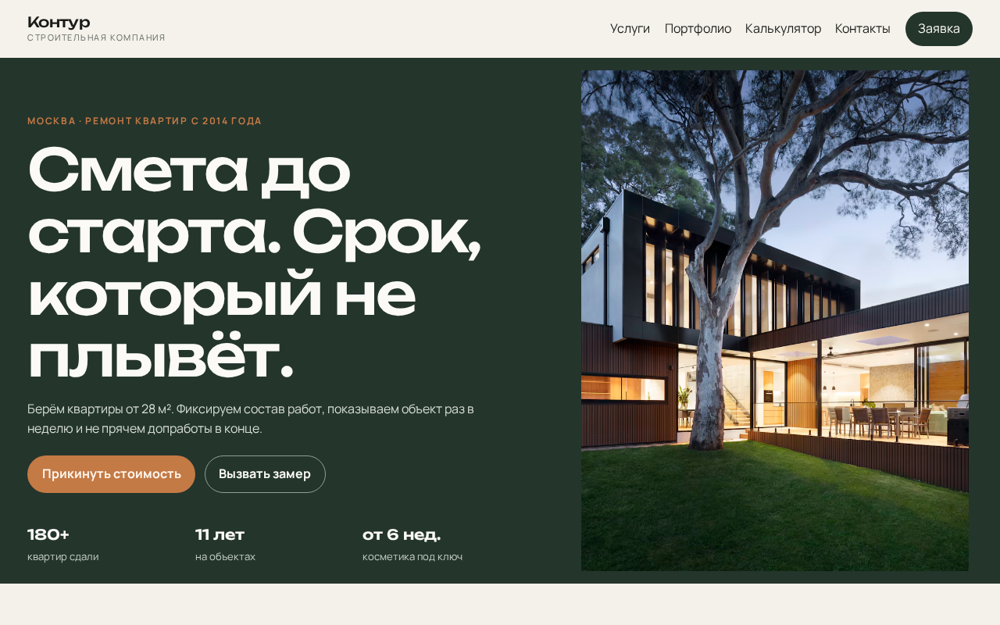

# Строительная компания «Контур»

Демо: https://swattt555333.github.io/build-company/

Сайт-визитка московской ремонтной компании. Он объясняет, какие работы компания берёт, показывает готовые квартиры и даёт заказчику прикинуть бюджет до звонка. Замер и договор в этой версии не оформляются: форма только проверяет поля и показывает подтверждение.

## Что умеет сайт

- Главный экран со сроком, стажем и двумя действиями: калькулятор и заявка на замер.
- Шесть карточек услуг: косметический, капитальный и дизайнерский ремонт, электрика, сантехника, комплектация. У каждой карточки есть срок и цена «от».
- Портфолио из восьми фотографий. Клик открывает снимок на весь экран. Листание стрелками на экране и клавишами ← →, закрытие по Escape, по кнопке «Закрыть» и по клику на тёмный фон. Фокус остаётся внутри окна, пока оно открыто.
- Калькулятор считает ориентир по площади от 20 до 180 м². База: 9 500 ₽/м² косметика, 18 500 ₽/м² капитальный, 32 000 ₽/м² дизайнерский. Сверху можно включить электрику (+1 800 ₽/м²), сантехнику (+2 200 ₽/м²), тёплый пол (+950 ₽/м²) и черновые материалы (+15% к сумме). Справа виден итог, вилка от 90% до 112% и строки расчёта. Ползунок и поле площади связаны. Это не оферта.
- Форма заявки проверяет имя, телефон, тип объекта и площадь от 15 до 500 м². После успеха поля скрываются, появляется текст, что данные не отправлены.
- Бургер-меню на узком экране, закреплённая шапка, плавные якоря, появление блоков при прокрутке.

## Технологии

- HTML5 и CSS3 без фреймворков и сборщиков.
- Ванильный JavaScript в `js/main.js`.
- Шрифты Unbounded и Manrope (Google Fonts), кириллица поддерживается.
- Фотографии — прямые ссылки Unsplash, нужен интернет.

## Структура

```text
build-company/
├── index.html       главная: услуги, портфолио, калькулятор, заявка, контакты
├── css/style.css    палитра, карточки, галерея, смета, лайтбокс
├── js/main.js       меню, лайтбокс, калькулятор, проверка заявки
├── img/favicon.svg  значок вкладки
├── img/screenshot-desktop.png
├── img/screenshot-mobile.png
└── README.md
```

## Как открыть локально

1. Сохраните папку `build-company` на компьютер.
2. Откройте `index.html` двойным щелчком.
3. Подвигайте площадь в калькуляторе и откройте любую фотографию из портфолио.

## Как опубликовать на GitHub Pages

1. Создайте публичный репозиторий, например `build-company`.
2. Загрузите файлы так, чтобы `index.html` был в корне, рядом с папками `css`, `js` и `img`.
3. Settings → Pages → Branch `main`, папка `/root` → Save.
4. Дождитесь адреса `https://swattt555333.github.io/build-company/`.
5. На опубликованной странице проверьте лайтбокс на телефоне: кнопки должны попадать под палец.

## Скриншоты




## Автор

InterPanic
